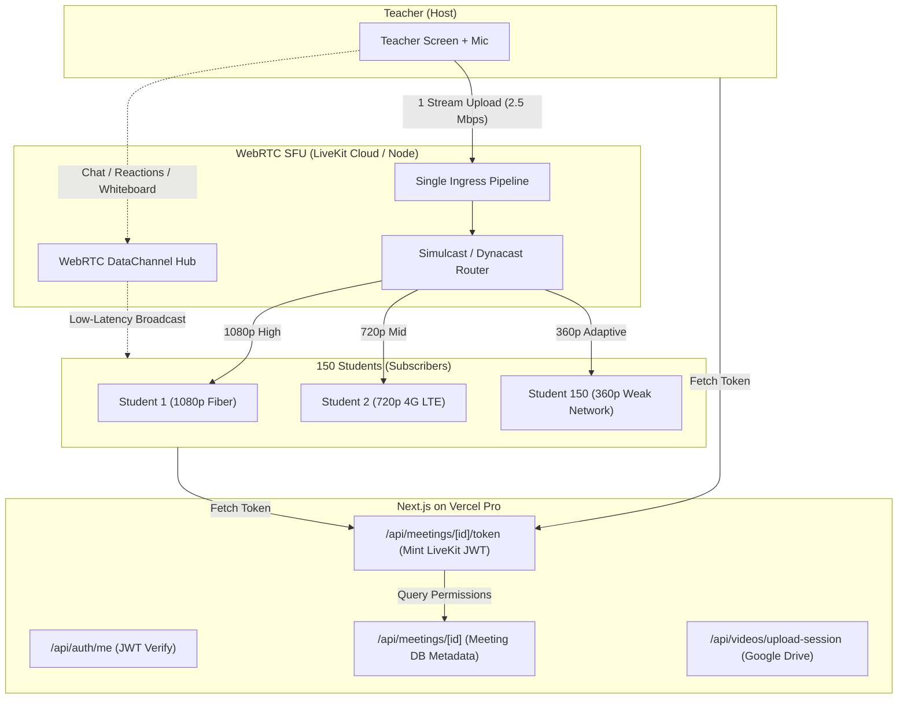

# GEONIXA LIVE CLASS: 150-STUDENT SFU MEDIA ARCHITECTURE

**Document Version:** 1.0.0  
**Target Scale:** 1 Teacher + 150 Students (Expandable to 1,000+ Students)  
**Deployment Platform:** Vercel Pro + WebRTC SFU (LiveKit Cloud / Self-Hosted SFU)  
**Target Latency:** < 150ms End-to-End Latency across India & Global  

---

## 1. Architectural Strategy & Provider Selection

### 1.1 Provider & Technology Comparison

| Evaluation Criteria | LiveKit (Selected) | Agora | Daily.co | 100ms |
| :--- | :--- | :--- | :--- | :--- |
| **Open Source Available** | **Yes (100% Open Source)** | No (Proprietary SDK) | No (Proprietary SDK) | No (Proprietary SDK) |
| **Vendor Lock-in Risk** | **Zero (Can switch cloud <-> self-hosted anytime)** | Complete lock-in | Complete lock-in | Complete lock-in |
| **India Edge Routing** | **Yes (Mumbai Edge Nodes)** | Yes (Mumbai / Hyderabad) | Limited India coverage | Yes (Mumbai) |
| **Bandwidth Cost Model** | **$0.05 / GB egress** (Generous free tier) | **$0.0039 / participant-minute** | **$0.004 / participant-minute** | **$0.004 / participant-minute** |
| **Cost for 150 Students (1 Hr Class)** | **~$2.70** (54 GB @ 800 kbps) | **$35.10** | **$36.00** | **$36.00** |
| **Cost for 30 Classes / Month** | **~$81.00 / month** | **$1,053.00 / month** | **$1,080.00 / month** | **$1,080.00 / month** |
| **Self-Hosted Option** | **Yes ($40/mo VPS for unlimited classes)** | Not possible | Not possible | Not possible |
| **Next.js Integration** | **Native npm packages (`livekit-client`, `livekit-server-sdk`)** | Heavy JS wrapper | React SDK wrapper | Custom Web SDK |

### 1.2 Decision Rationale
**LiveKit** is selected as the production WebRTC SFU architecture for Geonixa because:
1. **Dramatic Cost Advantage**: Agora and Daily charge on a participant-minute basis ($35+ per single 150-student class). LiveKit charges bandwidth egress (~$2.70 per class on LiveKit Cloud, or $0 additional cost when hosted on a dedicated Hetzner/AWS instance).
2. **Zero Vendor Lock-in**: LiveKit is fully open source. Geonixa can launch on LiveKit Cloud for instant turnkey setup and later migrate to a self-hosted instance without changing a single line of frontend code.
3. **Simulcast & Dynacast**: Automatically streams high quality (1080p) to students with fast Wi-Fi and scales down to 720p or 360p for students on weak mobile 4G networks without degrading the class for others.
4. **Data Channels**: Real-time chat, whiteboard slide sync, hand raises, and emoji reactions route over WebRTC Data Channels directly through the SFU, eliminating 455 HTTP requests/sec hitting Vercel serverless functions.

---

## 2. High-Level Architecture Diagram

---

## 3. Teacher and Student Flow

### 3.1 Teacher Publishing Pipeline
1. Teacher starts screen share in classroom.
2. The browser requests screen video (`1920x1080` at `30-60 fps`) and tab audio.
3. The video track is published to the SFU with **simulcast layers**:
   - Layer 1 (Full): 1080p, 2.5 Mbps max.
   - Layer 2 (Medium): 720p, 1.0 Mbps max.
   - Layer 3 (Low): 360p, 350 kbps max.
4. Teacher uploads **only once** to the SFU server, consuming ~2.5 Mbps of upstream bandwidth regardless of whether 1 student or 150 students are watching!

### 3.2 Student Subscription Pipeline
1. Student enters meeting room URL (`/meetings/room/[id]`).
2. Student browser requests an authenticated short-lived room token from `/api/meetings/[id]/token`.
3. The Next.js API route validates meeting password, role, and course enrollment, and mints an encrypted LiveKit Access Token.
4. Student connects to the SFU with `canPublish: false` and `canSubscribe: true`.
5. The SFU dynamically sends the highest resolution the student's individual network can sustain without buffering.

---

## 4. Security & SaaS Tenant Isolation

- **Short-Lived Access Tokens**: Tokens expire after 4 hours and are signed with a cryptographically secure `LIVEKIT_API_SECRET`.
- **Role Scoping**:
  - Teacher: `canPublish: true`, `canSubscribe: true`, `canPublishData: true`, `roomAdmin: true`.
  - Student: `canPublish: false` (cannot hijack screen share), `canSubscribe: true`, `canPublishData: true`.
- **Room Isolation**: Every class room is identified by its unique `roomId`. Tokens only grant access to that specific room ID. Students cannot access another tenant or classroom.
- **Credential Protection**: Media server keys (`LIVEKIT_API_KEY`, `LIVEKIT_API_SECRET`) remain strictly in server-side environment variables and are never transmitted to the browser or committed to Git.
